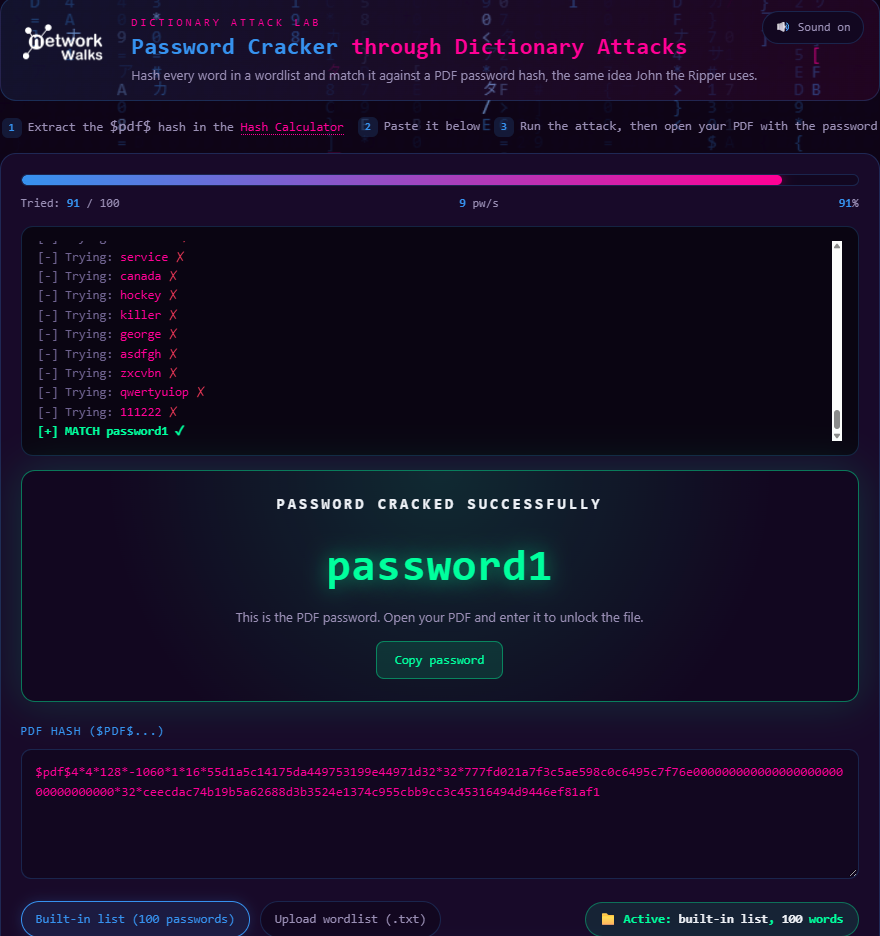
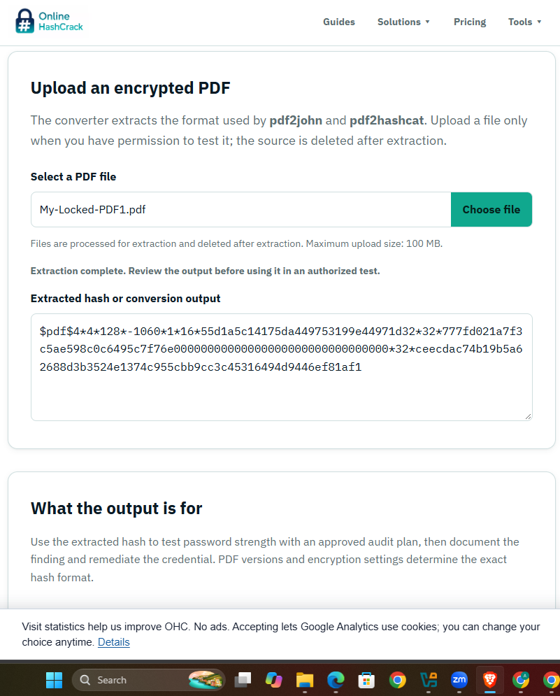
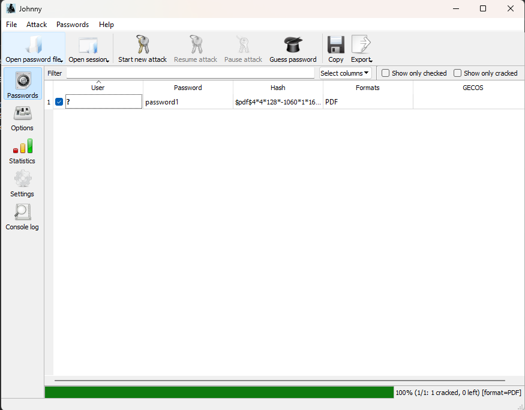

# NETWORKWALKS-OLUWADUROTIMI-B084M-WK1-PM1-PDF-PASSWORD-CRACKING-LAB

# Cracking the Lock: A PDF Password Recovery Exercise

# Week 3 Practical — NetworkWalks Cybersecurity Program

# What This Project Is About

Every password-protected file hides its password behind a cryptographic wall — but that wall isn’t magic, it’s math. This week’s practical pulled back the curtain on exactly how that wall is built, and more importantly, how a weak password can bring it down in minutes.

The challenge: three password-locked PDF files. The mission: recover all three passwords using the same core technique real penetration testers use when assessing whether an organization’s document-protection policies actually hold up under pressure.

# What I Set Out to Learn

Rather than just “crack three files and move on,” I wanted this exercise to actually teach me the mechanics underneath the tools:

How a PDF’s password protection is converted into a crackable hash in the first place.
The role a hash-extraction step plays before any cracking tool can even begin working.
How a dictionary attack systematically narrows down a password, word by word, until it finds a match.
Hands-on time with John the Ripper, one of the most widely used password-auditing tools in the industry, both via its GUI front-end and in a guided web-based simulation.
Why “password1”-style passwords are a security team’s worst nightmare — and exactly how fast they fall.

# Tools in Play
Windows Server — the base environment for the exercise
Johnny — a graphical front-end for John the Ripper, useful for visualizing an attack in progress without memorizing command-line flags
Online HashCrack’s PDF hash extractor — converts a locked PDF into the exact hash format pdf2john/pdf2hashcat would produce, which is the format any cracking tool actually needs to work with
NetworkWalks’ interactive Dictionary Attack simulator — a visual, step-by-step breakdown of how a wordlist-based attack actually tests candidates one at a time

# How the Exercise Unfolded

Step 1 — Extracting the Hash
A password-protected PDF doesn’t hand over its password hash freely — you first have to extract it in a format a cracking tool understands. Using the hash extractor, I converted My-Locked-PDF1.pdf into its raw hash:

$pdf$4*4*128*-1060*1*16*55d1a5c14175da449753199e44971d32*32*777fd021a7f3c5ae598c0c6495c7f76e000...*32*ceecdac74b19b5a62688d3b3524e1374c955cbb9cc3c45316494d9446ef81af1

That string is the actual target — everything from here on is about testing candidate passwords against it until one produces a matching result.

Step 2 — Loading the Hash into a Cracker
With the hash in hand, I loaded it into Johnny, John the Ripper’s GUI, which let me track the attack’s progress in real time rather than watching a bare terminal scroll by. The interface confirmed the hash format as PDF and flagged it ready for attack.

Step 3 — Watching the Dictionary Attack Work
Running the same hash through NetworkWalks’ guided dictionary-attack simulator made the logic of the attack visible in a way a plain terminal never does: the tool worked through a 100-password built-in list — service, canada, hockey, killer, george, asdfgh, zxcvbn, qwertyuiop, 111222 — testing each one in sequence until, at attempt 91 of 100, it hit a match.

Step 4 — The Password Falls

[+] MATCH password1 ✓

The password behind that entire cryptographic hash turned out to be password1 — recovered in seconds, purely because it’s a word already sitting in the first hundred entries of any basic wordlist. Johnny’s GUI confirmed the same result independently, showing the file as 100% cracked.

Step 5 — Capturing the Flag
Completing the exercise unlocked the week’s proof-of-work flag:

nw{networkwalks_flag1_jtr_270521_1}

# The Real Lesson Here

It’s tempting to treat this as “I ran a tool and got a password” — but the actual takeaway is bigger than that. The entire attack succeeded because the password was predictable, not because the encryption was weak. The cryptography protecting that PDF was sound; the password choice is what failed. A dictionary attack like this one is only fast because it’s betting — correctly, most of the time — that humans reuse the same handful of weak, guessable passwords over and over.

That’s the real-world implication worth sitting with: strong encryption means nothing if the password behind it is something a 100-word list can guess. This is exactly the kind of finding a penetration tester flags in a client report — not “your encryption is broken,” but “your password policy is.”

# What I Took Away From This
A concrete, hands-on understanding of how PDF password hashes are structured and extracted
Direct experience with John the Ripper, both through its GUI (Johnny) and in a guided simulation of its underlying logic
A clearer sense of why dictionary attacks work as well as they do against real-world passwords
Reinforced appreciation for why password strength — not just encryption strength — is a critical, independent line of defense.

# Ethical Note

This exercise was performed exclusively on PDF files I created and was authorized to test, within my own personal, approved lab environment, as part of structured cybersecurity training. No unauthorized systems or files were accessed at any point.

# 👤 Author

Oluwadurotimi Adedokun Adeyemi
Cybersecurity Professional | NetworkWalks Training — B084M

# 📌 Project Information

Program: NetworkWalks Cybersecurity Internship | Week: 03 | Focus: Password Security & Ethical Hacking | Tools: Windows, John the Ripper, Johnny, Online HashCrack, NetworkWalks Dictionary Attack Simulator

# Evidence Collected

-End-
